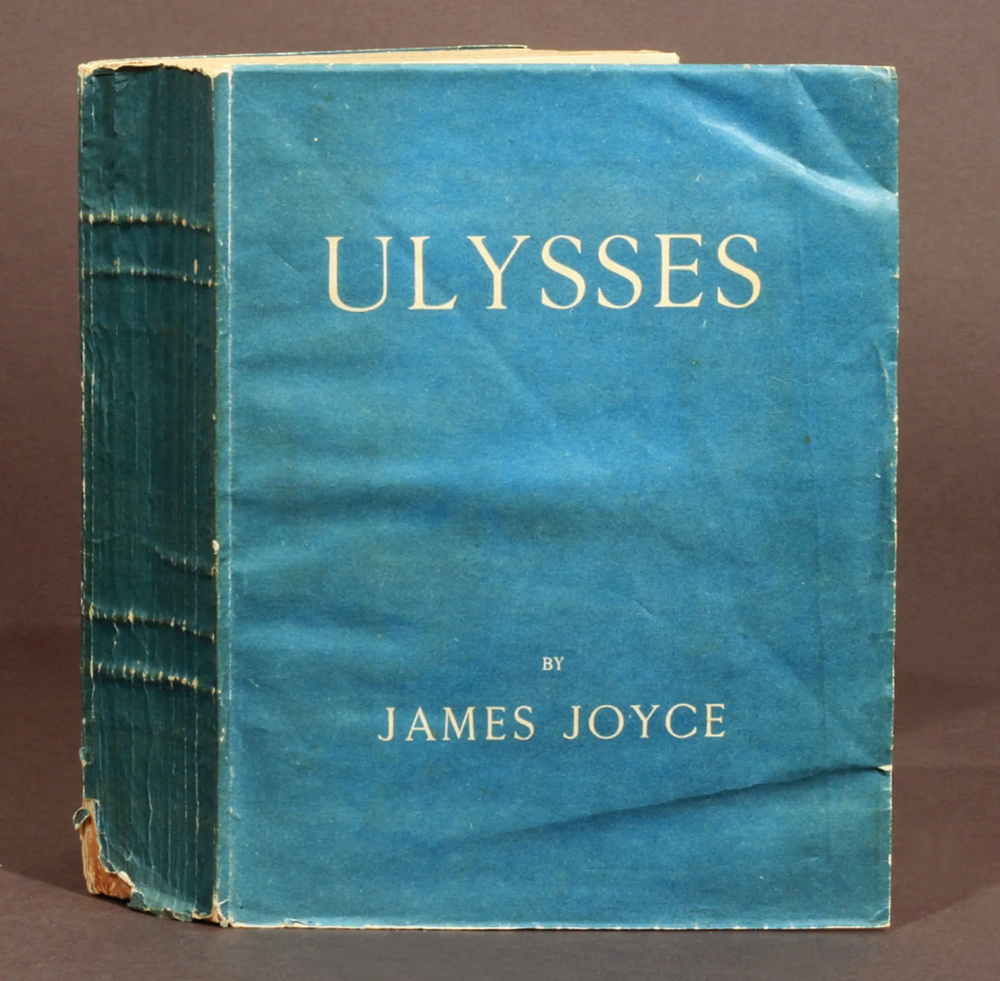

## James Joyce's *Ulysses*: Named-Entity Sentiment Analysis

<blockquote>
  <p><i>
  "Stately, plump Buck Mulligan came from the stairhead, bearing a bowl of lather on which a mirror and a razor lay crossed. A yellow dressinggown, ungirdled, was sustained gently behind him on the mild morning air. He held the bowl aloft and intoned: Introibo ad altare Dei."
    - James Joyce
</i></p>
</blockquote>
<br>

<p>In this project, I used sentiment analysis to explore which of the novel's 30 main characters are written about in warmer or darker language. Each character gets a score from −1 to 1: closer to 1 means the language around them is mostly upbeat, closer to −1 mostly grim. <i>Ulysses</i> makes this a fun experiment: it has a huge cast of characters who go by many different names, and its writing style changes from chapter to chapter. Does the model pick up on the characters, or on Joyce's shifting styles?</p>

Methods:
- Scraped the HTML edition of the novel with `requests` and extracted the text with `BeautifulSoup`
- Tokenized, lowercased, and removed stop words, comparing NLTK's and scikit-learn's stop word lists in word-frequency plots
- Mapped 88 name variations to 30 main characters (e.g. "Poldy" and "Henry Flower" → Leopold Bloom)
- Matched names as whole words with a single regex, longest variation first, so "Mr Dedalus" (Simon) isn't credited to "Dedalus" (Stephen)
- Scored each sentence once with VADER and averaged the scores per character, keeping the number of sentences behind each average

Findings:
- The model picks up Joyce's styles more than the characters. Gerty MacDowell scores highest (0.26), with her friends Cissy Caffrey and Edy Boardman close behind, because Joyce writes their chapter in the style of a sentimental romance novel. At the bottom are Paddy Dignam (−0.06), whose funeral fills an entire chapter, and Rudy Bloom, who died in infancy
- Leopold Bloom is mentioned in 980 sentences, nearly twice as many as Stephen Dedalus (583)
- Most scores sit close to neutral, and a few rest on fewer than a dozen sentences, so small gaps between characters aren't meaningful

Run it:
```bash
pip install requests beautifulsoup4 nltk vaderSentiment pandas matplotlib seaborn scikit-learn jupyter
jupyter notebook Ulysses-named-entity-analysis.ipynb
```
The notebook downloads the novel from Project Gutenberg when it runs.

<p></p>
