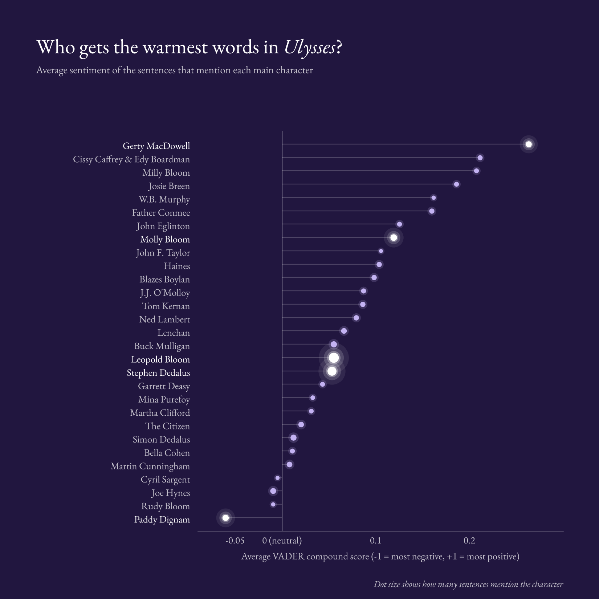
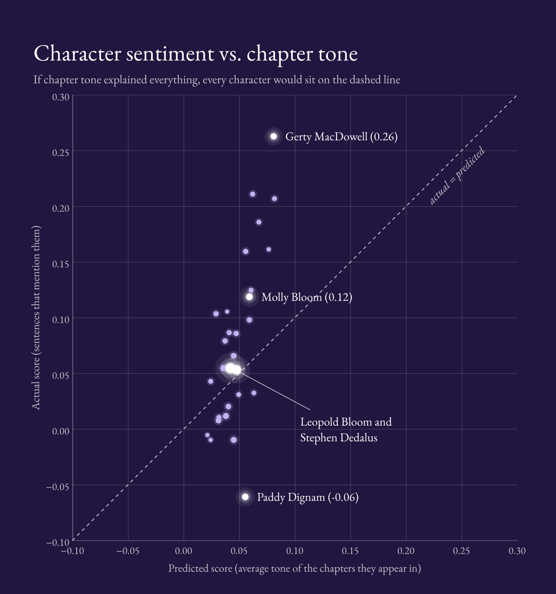

## James Joyce's *Ulysses*: Named-Entity Sentiment Analysis

<blockquote>
  <p><i>
  "Stately, plump Buck Mulligan came from the stairhead, bearing a bowl of lather on which a mirror and a razor lay crossed. A yellow dressinggown, ungirdled, was sustained gently behind him on the mild morning air. He held the bowl aloft and intoned: Introibo ad altare Dei."
    - James Joyce
</i></p>
</blockquote>
<br>

<p>In this project, I used sentiment analysis to explore which of the novel's 30 main characters are written about in warmer or darker language. Each character gets a score from −1 to 1: closer to 1 means the language around them is mostly upbeat, closer to −1 mostly grim. <i>Ulysses</i> makes this a fun experiment: it has a huge cast of characters who go by many different names, and its writing style changes from chapter to chapter. Does the model pick up on the characters themselves, or on Joyce's shifting styles?</p>



Methods:
- Scraped the HTML edition of the novel with `requests` and extracted the text with `BeautifulSoup`
- Tokenized, lowercased, and removed stop words, comparing NLTK's and scikit-learn's stop word lists in word-frequency plots
- Mapped 88 name variations to 30 main characters (e.g. "Poldy" and "Henry Flower" → Leopold Bloom)
- Matched names as whole words with a single regex, longest variation first, so "Mr Dedalus" (Simon) isn't credited to "Dedalus" (Stephen)
- Scored each sentence once with VADER and averaged the scores per character, keeping the number of sentences behind each average
- Tested whether the scores just reflect chapter tone: scored all 18 chapters, then compared each character's score with the average tone of the chapters they appear in. If chapter tone drove the results, the two would match

Findings:
- Chapter tone explains only part of the character ranking. Characters in sunnier chapters tend to score higher, but chapter tone accounts for only about 12% of the variation in scores, and the characters at the top and bottom score very differently from the chapters they appear in. Gerty MacDowell scores highest (0.26), far above the 0.08 predicted from her chapters, though part of that may still be style: her half of chapter 13 is written like a romance novel, while Bloom's half isn't. Paddy Dignam scores lowest (−0.06), below the tone of every chapter, because his death comes up throughout the novel
- In the chart below, each dot is a character. If chapter tone explained the scores, the dots would fall along the dashed line; instead they spread out vertically, with Gerty far above it and Dignam far below
- Most scores sit close to neutral, and a few rest on fewer than a dozen sentences, so small gaps between characters aren't meaningful



Run it:
```bash
pip install requests beautifulsoup4 nltk vaderSentiment pandas matplotlib seaborn scikit-learn scipy jupyter
jupyter notebook Ulysses-named-entity-analysis.ipynb
```
The notebook downloads the novel from Project Gutenberg when it runs.
